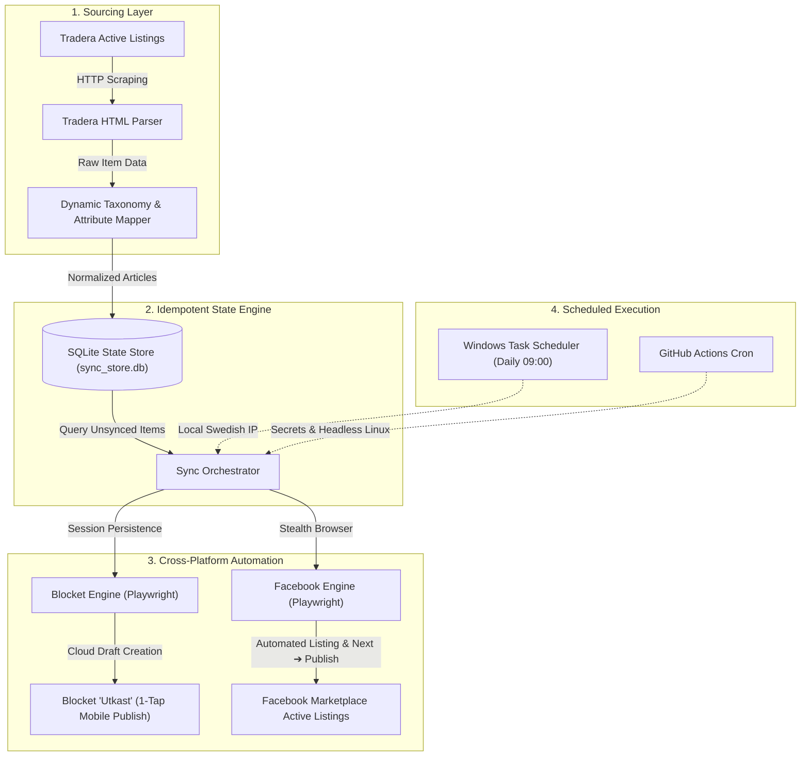

# Multi-Channel E-Commerce Inventory Synchronizer
### Automated Cross-Listing Engine: Tradera ➔ Blocket.se & Facebook Marketplace

[](https://github.com/AndreasAAR/Item_Trading_Bot/actions/workflows/daily_sync.yml)
[](https://www.python.org/downloads/)
[](https://playwright.dev/)
[](https://opensource.org/licenses/MIT)

An enterprise-grade cross-listing utility that automatically synchronizes active inventory from **Tradera** ([ODENPLAN SALES](https://www.tradera.com/profile/items/2195678/odenplan-sales)) to **Blocket.se** and **Facebook Marketplace**. Built with intelligent taxonomy mapping, resilient headless browser automation, and scheduled execution across local and CI/CD environments.

---

## 🏛️ System Architecture



---

## 🌟 Key Features

- **Multi-Platform Cross-Listing**: Simultaneously synchronizes inventory across Tradera, Blocket.se, and Facebook Marketplace.
- **Automated Sold Reconciliation & Unlisting**: Automatically detects items sold on Tradera (Buy Now or winning auction bidder) and unlists them from Blocket (both live **Aktiva** listings and **Utkast** drafts) and Facebook Marketplace.
- **Deduplication & Relist Intelligence**: Uses title normalization, fuzzy string similarity (>90%), and image signature hashing to detect relisted items and merge duplicates while preserving platform sync statuses.
- **Dynamic Taxonomy & Condition Mapping**: Translates Tradera categories and attributes into platform-specific taxonomies in both Swedish and English (e.g., Men's Clothing, Sporting Goods, Toys, Furniture).
- **Stealth Browser Automation**: Bypasses bot-detection mechanisms (such as Arkose Labs MatchKey) using persistent browser sessions, `--disable-blink-features=AutomationControlled`, and randomized human-like pacing delays (15s).
- **Idempotent SQLite State Machine**: Local database tracking ensures zero duplicate postings and tracks independent statuses (`discovered`, `drafted`, `published`, `sold`) per platform.
- **Blocket Cloud Draft Engine**: Injects images, structured descriptions, and attributes into Blocket cloud drafts (`Utkast`) for 1-tap mobile publishing.
- **Dual Execution Modes**:
  - **Local Windows Task Scheduler**: Runs silently daily at 09:00 AM using your native residential IP.
  - **GitHub Actions CI/CD**: Fully automated headless pipeline with GitHub Secrets for authentication.

---

## 🚀 Quickstart

### 1. Requirements
- Python 3.10+
- Google Chrome / Chromium

### 2. Installation
```bash
git clone https://github.com/AndreasAAR/Item_Trading_Bot.git
cd Item_Trading_Bot

pip install -r requirements.txt
playwright install chromium
```

### 3. Authentication (One-Time Setup)

#### Blocket.se
```bash
python -m src.cli login
```
*Opens an interactive browser window to log in via Schibsted/BankID once and saves the authenticated session state.*

#### Facebook Marketplace
```bash
# Option A: Interactive Browser Login (Recommended)
python -m src.cli fb-login

# Option B: Instant Cookie Import
python -m src.cli fb-login --c-user <YOUR_C_USER> --xs <YOUR_XS>
```

---

## 💻 CLI Commands

### Full Pipeline (One-Click Sync)
Fetches newly posted items from Tradera, drafts unsynced items to Blocket, and publishes them to Facebook:
```bash
# Sync both platforms
python -m src.cli sync --target all

# Run headless in background
python -m src.cli sync --target all --headless

# Sync only Blocket or Facebook
python -m src.cli sync --target blocket
python -m src.cli sync --target facebook
```

### Granular Commands
```bash
# Inspect all tracked items and multi-platform sync status
python -m src.cli list

# Detect sold items across Tradera, Blocket & Facebook and unlist cross-platform
python -m src.cli sync-sold
python -m src.cli sync-sold --dry-run

# Run the lightweight HTTP Profile Diff Listener across all 3 platforms
python -m src.cli watch --interval 180
python -m src.cli watch --once --dry-run

# Scan and merge duplicate or relisted items
python -m src.cli dedupe
python -m src.cli dedupe --merge

# Discover and refresh active items from Tradera
python -m src.cli fetch

# Batch draft to Blocket
python -m src.cli draft --all --delay 10.0

# Batch publish to Facebook Marketplace
python -m src.cli fb-draft --all --publish --delay 15.0
```

---

## ⏰ Automated Scheduling

### Option 1: Local Windows Task (Zero Datacenter Flags)
Registered to run silently every morning at 09:00 AM using your home IP:
```powershell
# Register the Windows Scheduled Task
powershell -ExecutionPolicy Bypass -File scripts\setup_windows_task.ps1

# Run on demand
Start-ScheduledTask -TaskName 'TraderaMultiPlatformSync'
```

### Option 2: GitHub Actions (Cloud Automation & 15-Min Profile Diff Listener)
- **Every 15 Minutes (`.github/workflows/profile_listener.yml`)**: Runs a ~4-second HTTP pre-check (`python -m src.cli watch --once --dry-run`) across Tradera, Blocket, and Facebook Marketplace. It **skips** downloading/launching Playwright Chromium unless an item was actually added or sold, keeping runs fast (~12s) and lightweight.
- **Daily Full Sync (`.github/workflows/daily_sync.yml`)**: Runs at `08:00 UTC`.
- **Setup**:
  1. Add `BLOCKET_AUTH_STATE`, `FB_AUTH_STATE`, and `TRADERA_AUTH_STATE` to your GitHub Repository Secrets.
  2. Both workflows commit database updates (`data/sync_store.db`) back to the repository automatically.

---

## ⚠️ Disclaimer & Ethical Use

> **Disclaimer**: This software is developed for educational purposes and personal inventory synchronization across platforms where the user maintains active seller accounts. It is designed to assist individuals in managing their own pre-owned goods across secondary marketplaces. Users are responsible for complying with the Terms of Service (ToS) and rate-limiting policies of all respective platforms.
