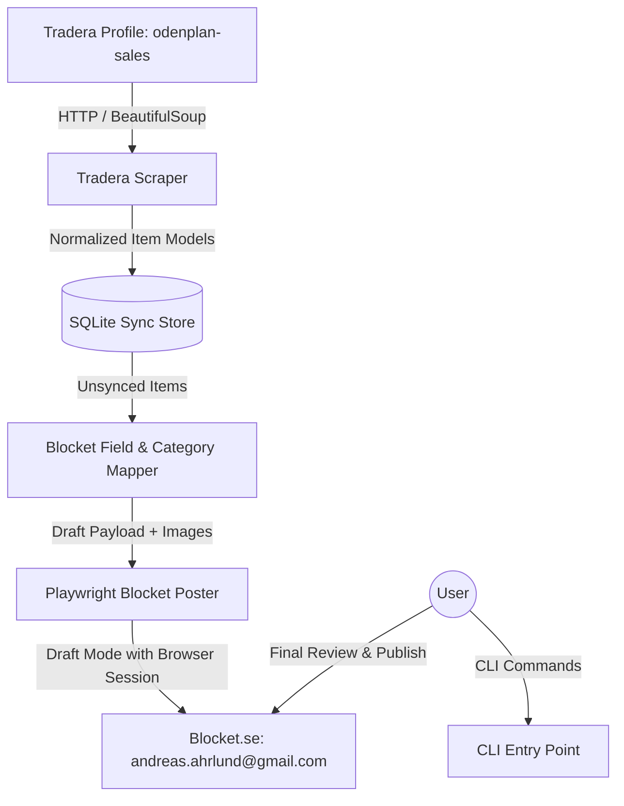

# System Architecture

## 1. Overview
The **Item Trading Bot** is a modular Python-based automation pipeline designed to discover, extract, normalize, and draft listings across Nordic marketplaces, specifically moving active items from **Tradera** to **Blocket**.

---

## 2. Subsystems & Responsibilities

### 2.1 Tradera Scraper (`src/tradera/`)
- **Responsibility**: Scrapes and extracts listings from the user's public Tradera profile and detailed item pages.
- **Key Components**:
  - `client.py`: Handles HTTP requests with appropriate headers and rate limiting.
  - `parser.py`: Parses profile HTML and detailed listing pages into structured Pydantic models.
  - `models.py`: Strongly typed schema representing Tradera items (prices, auction vs buy-now, attributes, images).

### 2.2 Sync Storage (`src/storage/`)
- **Responsibility**: Persists items, sync status, and audit trail in a local SQLite database (`data/sync_store.db`).
- **Key Components**:
  - `database.py`: SQLite connection and schema migrations.
  - `repository.py`: CRUD methods, deduplication checks, and status transitions (`discovered` -> `staged` -> `drafted` -> `published`).

### 2.3 Mapper & Image Processor (`src/mapper/`)
- **Responsibility**: Transforms Tradera item schemas into marketplace-compatible listing structures.
- **Key Components**:
  - `category_mapper.py`: Deep 3-level category hierarchy heuristics (`Huvudkategori`, `Underkategori`, `Produktkategori`), condition mapping (`map_condition`), and color normalization (`map_color`) for Blocket.
  - `fb_category_mapper.py`: Category and condition mapping for Facebook Marketplace (clothing, shoes, sports, home/furniture, toys) and clean description formatting.
  - `formatter.py`: Composes descriptive ad copy including sizing, brand, condition, and pickup notes.
  - `image_downloader.py`: Downloads high-resolution images to a temporary staging folder for uploading.

### 2.4 Blocket Automation Engine (`src/blocket/`)
- **Responsibility**: Automates browser interactions on Blocket.se via Playwright.
- **Key Components**:
  - `session.py`: Handles persistent browser context, saving/loading cookies and auth state (`data/blocket_auth_state.json`).
  - `drafter.py`: Automates the Blocket recommerce ad wizard, populating full structured information brackets (3-level categories, Skick, Färg, Passform, Storlek, Varumärke, Material, Title, Description, Price, and Postal Code `11322`).
  - `cleaner.py`: Automates purging of outdated cloud drafts from *Mina annonser -> Utkast*.

### 2.5 Facebook Marketplace Automation Engine (`src/facebook/`)
- **Responsibility**: Automates listing creation on Facebook Marketplace via Playwright.
- **Key Components**:
  - `session.py`: Handles persistent browser context, saving/loading session storage state (`data/fb_auth_state.json`).
  - `drafter.py`: Automates the Facebook Marketplace listing wizard (`/marketplace/create/item`), uploading multi-image photos, filling Title, Price, Category, Condition, and Description.

### 2.6 CLI Interface (`src/cli/main.py`)
- **Responsibility**: Clean command-line user interface using `argparse` and rich formatted tables.
- **Key Commands**: `fetch`, `list`, `login`, `fb-login`, `draft`, `fb-draft`, `sync --target [blocket|facebook|all]`, `clean-drafts`.

---

## 3. Execution Flows

### Flow A: Fetch & Discovery
1. User runs `python -m src.cli fetch`.
2. `TraderaScraper` fetches `https://www.tradera.com/profile/items/2195678/odenplan-sales`.
3. Discovers all active item cards (e.g. 37 items).
4. For any new or modified item ID, fetches the detailed listing page to capture full description and high-res images.
5. Saves new items into SQLite with status `discovered`.

### Flow B: Interactive Blocket Authentication
1. User runs `python -m src.cli login`.
2. Playwright launches Chromium with a visible head (`headless=False`).
3. User completes login (BankID or email code).
4. Playwright exports browser storage state to `data/blocket_auth_state.json`.

### Flow C: Cloud Drafting to Blocket Account
1. User runs `python -m src.cli draft [--item-id <id> | --all | --limit <N>]`.
2. `SyncRepository` retrieves unsynced items.
3. `Mapper` prepares the title, description, category suggestion, and stages high-res images.
4. Playwright opens Blocket with saved authentication cookies.
5. Populates the ad creation wizard (title, category chip, price, description, and attached images).
6. Automatically advances to the preview/summary step (`auto_save_to_cloud=True`), which triggers Blocket's server-side persistence.
7. The ad is now safely stored under **Mitt Blocket -> Mina annonser -> Utkast**.
8. Local SQLite database marks the item as `drafted`.
9. The user opens the **Blocket Mobile App** on their phone at their convenience to review the drafts and publish them with BankID.

