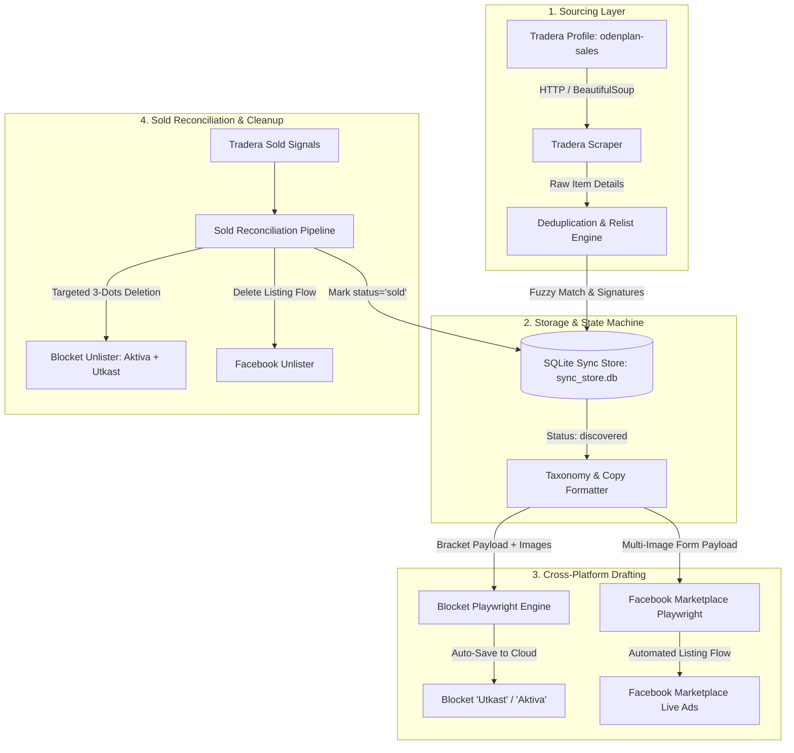

# System Architecture

## 1. Overview
The **Item Trading Bot** is a modular Python-based cross-listing and inventory synchronization engine designed to discover, extract, normalize, cross-post, and reconcile listings across Nordic marketplaces—specifically moving active items from **Tradera** to **Blocket.se** and **Facebook Marketplace**, while automatically cleaning up sold items across channels.

---

## 2. Subsystems & Responsibilities

### 2.1 Tradera Scraper (`src/tradera/`)
- **Responsibility**: Scrapes and extracts listings from the user's public Tradera profile and detailed item pages.
- **Key Components**:
  - `client.py`: Handles HTTP requests with appropriate headers, user agent, and rate limiting.
  - `parser.py`: Parses profile HTML and detailed listing pages into structured models; extracts pricing (Buy Now vs Auction), breadcrumb taxonomy, brands, and high-resolution image URLs (`large-fit`).
  - `models.py`: Strongly typed data schemas representing Tradera items (`TraderaItemCard`, `TraderaItemDetail`).

### 2.2 Storage & Deduplication Engine (`src/storage/`)
- **Responsibility**: Persists items, sync status, and audit trail in SQLite (`data/sync_store.db`), and provides fuzzy relist recognition.
- **Key Components**:
  - `database.py`: SQLite connection management, schema initialization, and transactional context.
  - `dedupe.py`: Title normalization, fuzzy similarity ratio (>90%), image signature hash sets, and duplicate clustering.
  - `repository.py`: CRUD methods, relist recognition (`upsert_item_detailed`), duplicate cluster merging (`merge_duplicate_items`), and status transitions (`discovered` -> `drafted` -> `published` -> `sold`).

### 2.3 Cross-Platform Sold Reconciliation (`src/reconciliation/` & `unlister`)
- **Responsibility**: Detects when an item is sold on one platform and automatically cleans up corresponding listings/drafts across the other channels.
- **Key Components**:
  - `src/reconciliation/sold_checker.py` (`SoldReconciler`): Compares inventory against the active seller profile, checks missing listings for positive sold markers (`såld med köp nu`, `vann auktionen`, `slutpris`), and orchestrates multi-platform unlisting.
  - `src/blocket/unlister.py` (`BlocketUnlister`): Scans both the **`Aktiva`** tab (live published listings) and the **`Utkast`** tab (saved drafts). Deletes sold items via the card's 3-dots action menu (`...` -> `Ta bort` -> confirm `<w-modal>`), avoiding the broken "Markera som såld" flow when no chat thread exists.
  - `src/facebook/unlister.py` (`FacebookUnlister`): Navigates to `/marketplace/you/selling`, finds the card, opens `...`, clicks `Ta bort annons`, chooses "Sold elsewhere" (*Sålde någon annanstans*), and confirms.

### 2.4 Taxonomy Mapper & Image Processor (`src/mapper/`)
- **Responsibility**: Transforms raw Tradera item schemas into marketplace-specific listing structures.
- **Key Components**:
  - `category_mapper.py`: Deep 3-level category hierarchy heuristics (`Huvudkategori`, `Underkategori`, `Produktkategori`), condition mapping (`map_condition`), and color normalization (`map_color`) for Blocket.
  - `fb_category_mapper.py`: Category and condition mapping for Facebook Marketplace (clothing, shoes, sports, home/furniture, toys) and clean description formatting.
  - `formatter.py`: Composes descriptive ad copy including sizing, brand, condition, and pickup notes.
  - `image_downloader.py`: Downloads high-resolution images to a temporary staging folder for uploading.

### 2.5 Blocket Automation Engine (`src/blocket/`)
- **Responsibility**: Automates browser interactions on Blocket.se via Playwright.
- **Key Components**:
  - `session.py`: Handles persistent browser context, saving/loading cookies and auth state (`data/blocket_auth_state.json`).
  - `drafter.py`: Automates the Blocket recommerce ad wizard, populating full structured information brackets (3-level categories, Skick, Färg, Passform, Storlek, Varumärke, Material, Title, Description, Price, and Postal Code `11322`).
  - `unlister.py`: Targeted unlisting of active ads and deletion of drafts for sold items.
  - `cleaner.py`: Automates bulk purging of outdated cloud drafts from *Mina annonser -> Utkast*.

### 2.6 Facebook Marketplace Automation Engine (`src/facebook/`)
- **Responsibility**: Automates listing creation and deletion on Facebook Marketplace via Playwright.
- **Key Components**:
  - `session.py`: Handles persistent browser context, stealth bot overrides (`--disable-blink-features=AutomationControlled`), and cookie management (`data/fb_auth_state.json`).
  - `drafter.py`: Automates the Facebook Marketplace listing wizard (`/marketplace/create/item`), uploading multi-image photos, filling Title, Price, Category, Condition, and Description.
  - `unlister.py`: Unlists and deletes listings from the Facebook Marketplace seller dashboard.

### 2.7 CLI Interface (`src/cli/main.py`)
- **Responsibility**: Unified command-line interface dispatching full pipelines and granular actions.
- **Key Commands**: `sync`, `sync-sold`, `dedupe`, `fetch`, `list`, `login`, `fb-login`, `draft`, `publish`, `fb-draft`, `clean-drafts`.

---

## 3. Core Execution Flows

### Flow A: Fetch & Relist-Aware Ingestion
1. User runs `python -m src.cli fetch` (or via `sync`).
2. `TraderaClient` retrieves active listing cards from the seller profile.
3. For each item card, detailed page HTML is parsed into a `TraderaItemDetail` model.
4. `SyncRepository.upsert_item_detailed()` checks:
   - If exact `item_id` exists: updates details and prices.
   - If item is a relist (matches title >90% or identical images): updates the `item_id` to the new listing while preserving existing sync statuses (`drafted` / `published`) so items are never duplicated!
   - If item is brand new: inserts with status `discovered`.

### Flow B: Sold Item Reconciliation & Multi-Channel Unlisting
1. Triggered on every daily sync or via `python -m src.cli sync-sold`.
2. `SoldReconciler` compares local database items against the active Tradera profile.
3. For any missing item, checks the live Tradera listing:
   - If sold (`såld med köp nu`, `vann auktionen`, `slutpris`): marks as confirmed sold.
   - If ended without bids (`avslutades utan bud`): ignores to prevent unlisting items awaiting relisting.
4. For each confirmed sold item:
   - `BlocketUnlister` checks the **`Aktiva`** tab on Blocket; if found, deletes the live ad via `...` -> `Ta bort` -> confirm.
   - `BlocketUnlister` checks the **`Utkast`** tab; if found, deletes the draft.
   - `FacebookUnlister` removes the ad from Facebook Marketplace if listed.
   - Database updates local status to `'sold'` and logs the transition in `sync_logs`.

### Flow C: Cloud Drafting to Blocket Account
1. Triggered via `python -m src.cli sync --target blocket` or `python -m src.cli draft --all`.
2. `SyncRepository` retrieves unsynced items (`status = 'discovered'`).
3. For each item:
   - `Mapper` prepares title, description, 3-level category, attributes, and stages high-res images.
   - Playwright opens Blocket with saved authentication cookies.
   - Attaches photos, fills category chips, title, brand, material, description, price, and postal code.
   - Advances to the confirmation step (`auto_save_to_cloud=True`), persisting the ad in **Mitt Blocket -> Mina annonser -> Utkast**.
   - Database marks the item as `drafted`.
4. The user can review the draft on their mobile Blocket app and publish with 1-tap BankID.
